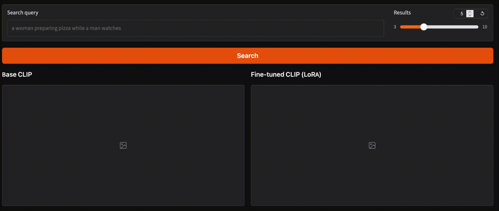
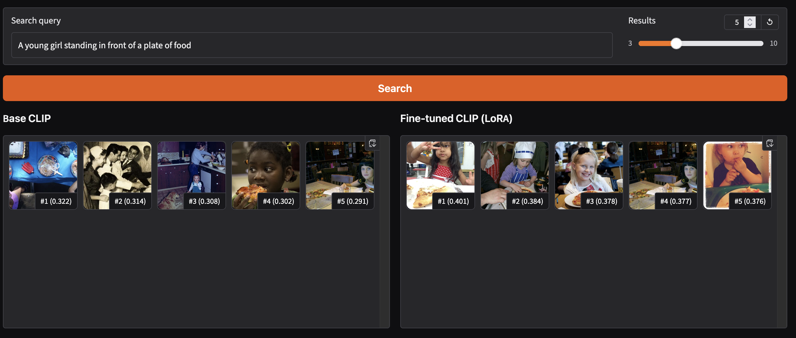
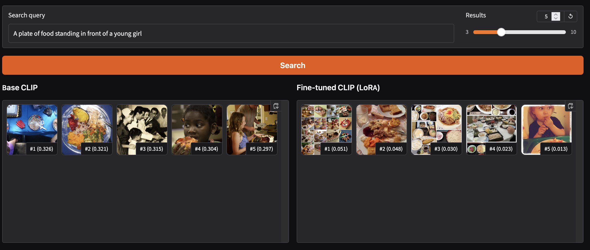
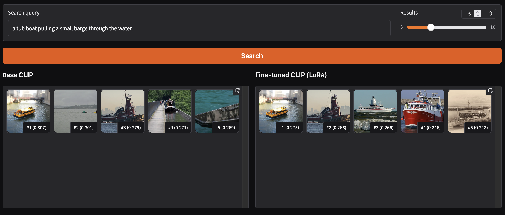
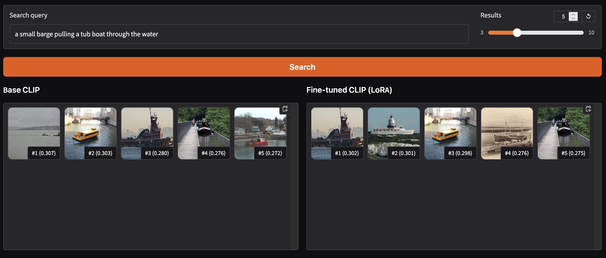
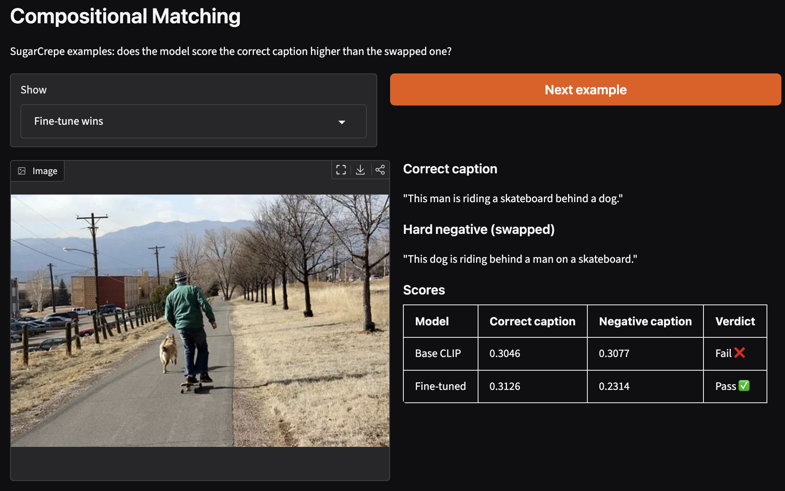
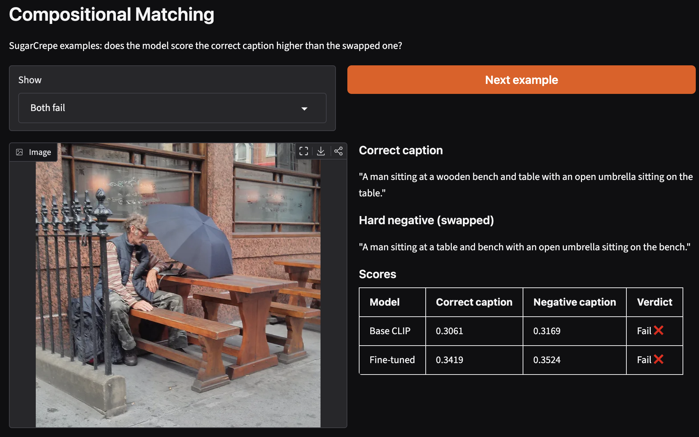

# CLIP-CompSearch



A compositional image search engine that triees to correctly rank relational queries (e.g. "a red mug *on top of* a blue book") that standard CLIP model usually gets wrong.

The search engine is powered by a text-side LoRA hard-negative fine-tuning, and it was evaluated on SugarCrepe with the standard retrieval preserved.

## The Problem

CLIP-based image search treats queries like a bag of words, which means that it retrieves the right objects but ignores how they relate to one another. In the standard CLIP-based search, "A dog sitting behind a pair of shoes" and "a pair of shoes sitting behind a dog" usually score nearly identically.

## The Fix

In order to fix this, I have fine-tuned  the CLIP's text encoder with LoRA using composition-aware hard negatives. This process is automated with a swap function supporting noun and adjective swaps, and a rule filter that removes swaps that keep the meaning (see [Why a rule filter replaces NLI](#why-a-rule-filter-replaces-nli)). However, CLIP's vision encoder is not updated, and only non-vision encoding parameters (0.62% of the total params.) were trained.

## Results

### SugarCrepe Compositional Accuracy

| Category    | Base CLIP | Fine-tuned |      Δ |
|-------------|-----------|------------|--------|
| swap_obj    |    61.2%  |     68.6%  | +7.4pp |
| swap_att    |    64.1%  |     71.5%  | +7.4pp |
| add_att     |    69.5%  |     83.2%  | +13.7pp |
| replace_rel |    69.4%  |     72.2%  | +2.8pp |
| add_obj     |    77.0%  |     89.3%  | +12.3pp |
| replace_att |    80.3%  |     79.8%  |  -0.5pp |
| replace_obj |    90.7%  |     91.6%  | +0.9pp |

Biggest gains on the hardest categories (swap/add), where CLIP was near chance.

### Retrieval Preservation (R@K on 500 COCO val images)

| Metric | Base CLIP | Fine-tuned |
|--------|-----------|------------|
| R@1    |    59.2%  |     56.8%  |
| R@5    |    86.8%  |     87.6%  |
| R@10   |    94.4%  |     95.2%  |

The standard retrieval stays intact within noise.

## Setup
```bash
git clone https://github.com/placeholder/clip-compsearch.git
cd clip-compsearch
python -m venv .venv
source .venv/bin/activate
pip install -r requirements.txt
python -m spacy download en_core_web_sm
```

#### Download the required data
```bash
# COCO val2017 images
mkdir -p data/coco
wget http://images.cocodataset.org/zips/val2017.zip -O data/coco/val2017.zip
unzip data/coco/val2017.zip -d data/coco/
rm data/coco/val2017.zip

# COCO captions
wget http://images.cocodataset.org/annotations/annotations_trainval2017.zip -O data/coco/annotations.zip
unzip -j data/coco/annotations.zip annotations/captions_val2017.json -d data/coco/
rm data/coco/annotations.zip

# SugarCrepe benchmark
mkdir -p data/sugarcrepe
git clone https://github.com/RAIVNLab/sugar-crepe.git /tmp/sugarcrepe
cp /tmp/sugarcrepe/data/*.json data/sugarcrepe/
rm -rf /tmp/sugarcrepe
```

## Usage
```bash
# Cache vision embeddings (run once)
python -m src.data.cache_embeddings

# Train the LoRA fine-tune
python -m src.finetune.train

# Evaluate on SugarCrepe (all categories)
python -m src.eval.matching

# Launch the search demo
python demo/app.py
```

## Demo

In the demo, I have included a **Search** tab for gallery retrieval and a **Matching** tab for controlled compositional tests. The matching tab shows the clearest improvement. At the gallery scale (in search), however, ranking changes are subtler because many visually similar images compete within narrow score margins.

### Where it works

<table>
<tr>
<td width="50%"></td>
<td width="50%"></td>
</tr>
<tr>
<td align="center"><small><i>The fine-tuned model ranks the correct image higher, while the base CLIP model treat both arrangements equally.</i></small></td>
<td align="center"><small><i>Both models fail.</i></small></td>
</tr>
</table>

### Where it fails

<table>
<tr>
<td width="50%"></td>
<td width="50%"></td>
</tr>
<tr>
<td colspan="2" align="center"><small><i>Both models return nearly identical results for both queries.</i></small></td>
</tr>
</table>


### Matching

<table>
<tr>
<td width="50%"></td>
<td width="50%"></td>
</tr>
<tr>
<td align="center"><small><i>In a majority of cases, the base CLIP scores the wrong caption higher, and the fine-tuned model corrects it.</i></small></td>
<td align="center"><small><i>However, some compositional swaps remain too subtle for either model.</i></small></td>
</tr>
</table>

## Methodology

1. Encode COCO val2017 images with frozen CLIP vision encoder (cached once)
2. Generate hard negatives via spaCy POS-swaps (nouns, adjectives) + a rule filter for symmetric swaps
3. Attach LoRA adapters (with parameters r=16, α=32) to the text encoder's query and value projections (q_proj, v_proj)
4. Train the model with InfoNCE contrastive loss so that each image prefers its caption over both random in-batch texts and its constructed hard negative
5. Evaluate on SugarCrepe (for compositional accuracy) and Recall@K (for retrieval)

All of the testing scripts are available under `notebooks/`

### Why a rule filter replaces NLI

The first version filtered the swaps with an NLI model (`cross-encoder/nli-deberta-v3-small`) and removed every pair labelled as entailment. A check on 2,000 COCO train2017 captions showed two problems:

- **It removed real negatives.** The model labelled 1,033 of 1,984 swap negatives (52%) as entailment. Many of them change the meaning, for example "A man in a crown wears a red jacket and is on the phone." → "A crown in a man wears a red jacket and is on the phone." A swap keeps every word of the caption, and NLI models tend to predict entailment when the premise and the hypothesis share their words (McCoy et al., 2019).
- **It kept swaps that keep the meaning.** It labelled "A dog and a cat sit on a sofa." → "A cat and a dog sit on a sofa." as contradiction.

The rule filter rejects a swap when the two swapped units are joined by "and" or "or", or by a symmetric relation: next to, beside, near, by, alongside, across from, opposite. The NLI scores are still stored with each pair, but they are not used for filtering.

## Training Configuration

| Parameter        | Value                         |
|------------------|-------------------------------|
| Base model       | openai/clip-vit-base-patch32  |
| LoRA rank        | 16                            |
| LoRA targets     | q_proj, v_proj (text encoder) |
| Trainable params. | 393,216 / 63.5M (0.62%)       |
| Learning rate    | 1e-5                          |
| Epochs           | 5                             |
| Batch size       | 32                            |
| Training data    | COCO val2017 (5000 images)    |
| Temperature      | 0.07                          |

## Limitations

- The model was trained on the COCO 2017 dataset, which has 5000 images. Given the small dataset size, it is possible to observe higher accuracy results if trained on a larger dataset. 
- The hard-negative generator used to train this model is limited to the noun and adjective swaps. Verb and preposition swaps are not supported.
- The model fails on cases where the visual distinction between arrangements is small.

## Project Structure
```
clip-compsearch/
├── src/
│   ├── search/
│   │   ├── engine.py
│   │   └── run_search.py
│   ├── eval/
│   │   ├── matching.py
│   │   └── recall_at_k.py
│   ├── data/
│   │   ├── negatives.py
│   │   └── cache_embeddings.py
│   └── finetune/
│       └── train.py
├── demo/
│   └── app.py
├── notebooks/
├── docs/images/
├── data/
├── checkpoints/
└── log.md
```

## References
- Radford et al., [Learning Transferable Visual Models From Natural Language Supervision](https://arxiv.org/abs/2103.00020)
- Yuksekgonul et al., [When and why vision-language models behave like bags-of-words, and what to do about it?](https://arxiv.org/abs/2210.01936)
- Hsieh et al., [SugarCrepe: Fixing Hackable Benchmarks for Vision-Language Compositionality](https://arxiv.org/abs/2306.14610)
- Hu et al., [LoRA: Low-Rank Adaptation of Large Language Models](https://arxiv.org/abs/2106.09685)
- Lin et al., [Microsoft COCO: Common Objects in Context](https://arxiv.org/abs/1405.0312)
- McCoy et al., [Right for the Wrong Reasons: Diagnosing Syntactic Heuristics in Natural Language Inference](https://arxiv.org/abs/1902.01007)

## Acknowledgements
- [COCO Dataset](https://cocodataset.org/) — CC-BY 4.0
- [HuggingFace PEFT](https://github.com/huggingface/peft) — Apache 2.0
- [spaCy](https://spacy.io/) — MIT License
- [Gradio](https://gradio.app/) — Apache 2.0